<div align="center">
  
</div>

# FlyPath

**FlyPath** is a free, open-source QGIS plugin for planning drone mapping and 3D capture missions and sending them straight to DJI Fly. It writes DJI's own WPML mission files (KMZ), so no conversion tools or third-party flight apps are needed.

Draw or pick a survey area in QGIS, choose a mission type, preview the route on the map, and save it to your computer or send it to the DJI RC over USB.

Developed and maintained by [Dronnix](https://www.dronnix.com), a drone mapping and geospatial AI company.

Follow FlyPath updates on [X (@SalarDrones)](https://x.com/SalarDrones) and [LinkedIn](https://www.linkedin.com/in/salar-ghaffarian).

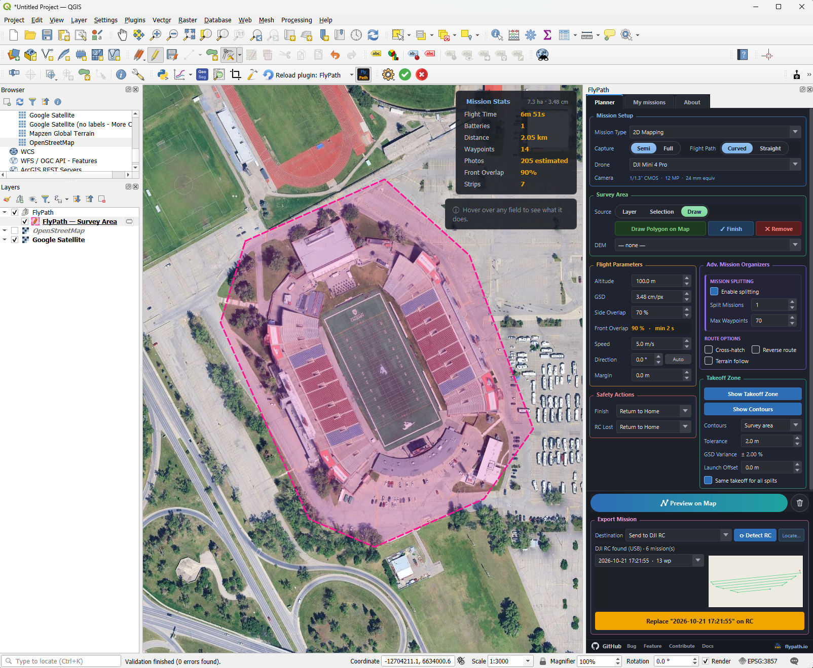

---

## Contents

- [What FlyPath does](#what-flypath-does)
- [Quick start](#quick-start)
- [Mission types](#mission-types)
- [Choosing how the drone flies](#choosing-how-the-drone-flies)
- [Terrain, takeoff and splitting](#terrain-takeoff-and-splitting)
- [Step-by-step guide](#step-by-step-guide)
- [Your missions on flypath.io](#your-missions-on-flypathio)
- [Supported drones](#supported-drones)
- [Requirements](#requirements)
- [Installation](#installation)
- [Known limitations](#known-limitations)
- [Contributing](#contributing)

---

## What FlyPath does

- **Four mission types:** 2D Mapping, Oblique Mapping, Corridor Mapping and Orbit (3D Model).
- **Plans with your GIS data:** draw an area, or use any polygon or line layer or a QGIS selection.
- **Shows the real route:** a live preview with flight time, distance, photos, waypoints and batteries.
- **Handles big jobs:** splits a survey into several flights by battery and waypoint limit.
- **Follows the ground:** optional terrain follow from free online elevation data or your own DEM.
- **Sends to the controller:** replaces a mission on the DJI RC over USB, with a picture of each mission so you pick the right one.
- **Works with flypath.io:** save missions to your free account and open them again in QGIS.

---

## Quick start

1. Install FlyPath from **Plugins > Manage and Install Plugins** (search for FlyPath).
2. Open it from **Plugins > FlyPath > FlyPath**. The panel opens on the right.
3. Choose a **Mission Type** and your **Drone**.
4. Under **Survey Area**, click **Draw** and draw your area on the map, or pick a layer.
5. Set the **Altitude** (or **GSD**) and the overlap, then click **Preview on Map**.
6. Under **Export Mission**, choose **Send to DJI RC** or **Save to computer** and export.

New to FlyPath? Watch the walkthrough:

[](https://www.youtube.com/watch?v=uhaE7L8n0Fc)

> The video was recorded on an earlier release, so the panel looks different and newer features are not shown, but the workflow is the same.

---

## Mission types

Pick the type under **Mission Setup > Mission Type**. The panel changes to show only the settings that type uses.

### 2D Mapping

A grid of flight lines over a survey area, with the camera straight down. Use it for orthomosaics, maps and elevation models.


- Lines stay inside irregular areas (L, U or notched shapes) instead of crossing the gaps.
- **Direction** sets the angle of the lines; **Auto** picks the angle that gives the shortest flight.
- **Margin** extends the area outward, to cover the edges.

### Oblique Mapping

The area photographed from four sides with a tilted camera, for 3D models of buildings, sites and terrain. Set the tilt with **Camera Angle** (default -45°). An optional **Nadir Pass** flies the area straight down first.

Choose one of two **Patterns**:

**Fast** (default): two crossing grids with the drone facing along each line, so neighbouring lines photograph opposite sides. About half the flight time of Full, and the drone always flies forwards.

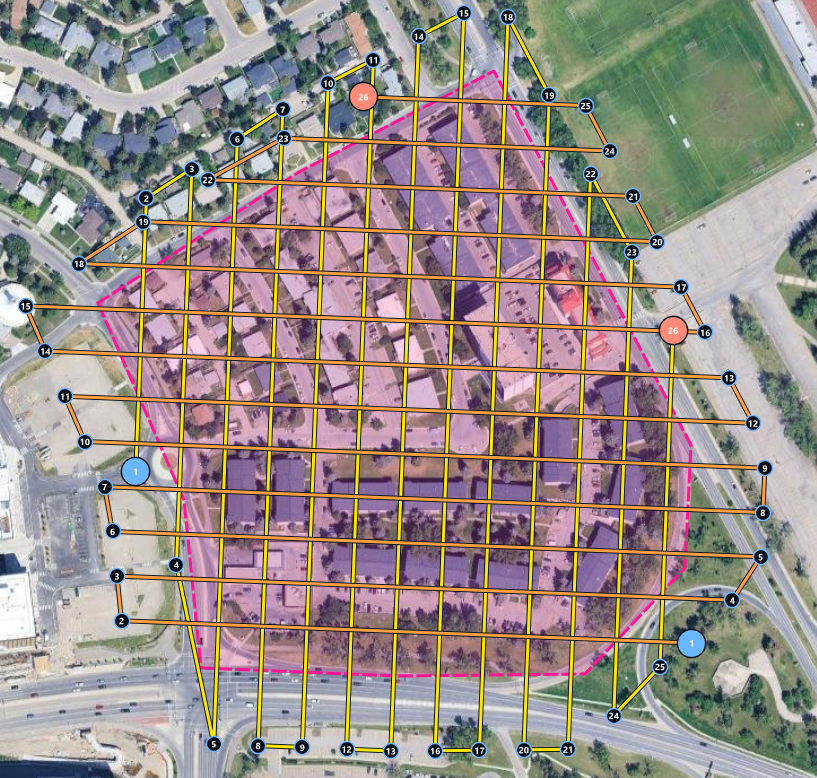

**Full:** four passes, one facing each side, like DJI Pilot 2's oblique routes. The drone holds its heading for the whole pass, so it flies some lines sideways or backwards. It gives the most complete 3D coverage.

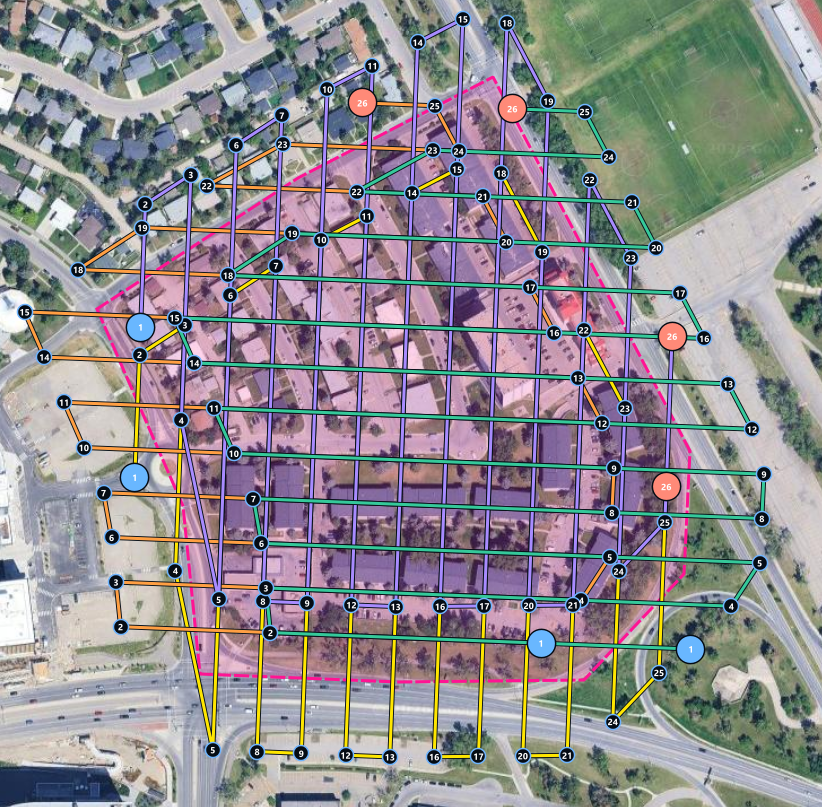

*Both pictures show the passes without the Nadir Pass.*

- Each pass reaches past the area by altitude / tan(camera angle), so the middle of every photo still lands inside the area and its edges are seen from every side.
- Line and photo spacing follow the tilted camera's distance to the ground, so the overlap you set is kept.
- Every pass flies as its own flights. The RC part picker names each one, for example **Nadir**, **Grid** or **Facing NE**.

### Corridor Mapping

Parallel passes along a centre line, for roads, pipelines, rivers and power lines. Draw or pick a line instead of a polygon, and set the **Buffer** (how far to map on each side).

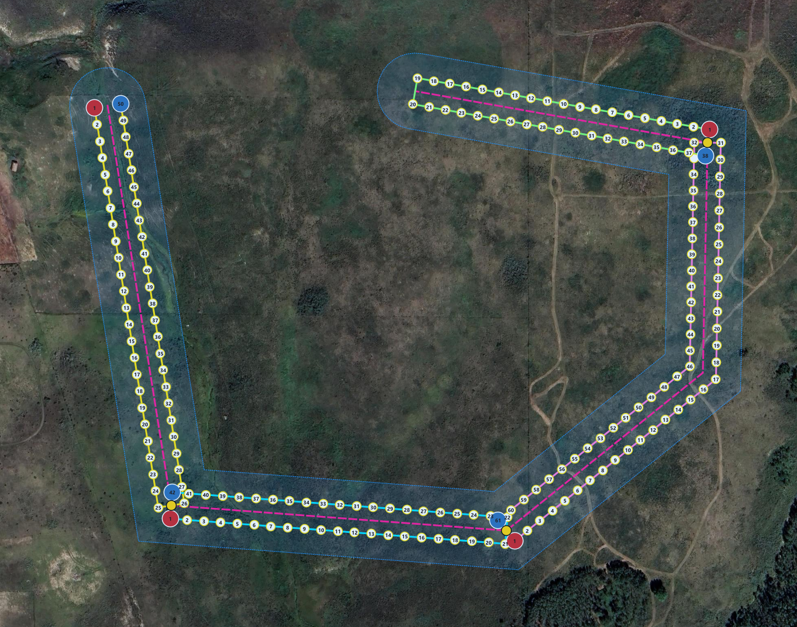

- FlyPath adds as many passes as the buffer needs, following the line's curves and corners.
- **Min Flights** splits the corridor into that many stretches, and **Set Mission Breaks** lets you click line vertices to force a break, for example at a safe landing spot.

### Orbit (3D Model)

Circles around an object with the camera facing it, for 3D models of buildings, towers and statues. Click the centre on the map, or press and drag to set the radius too.

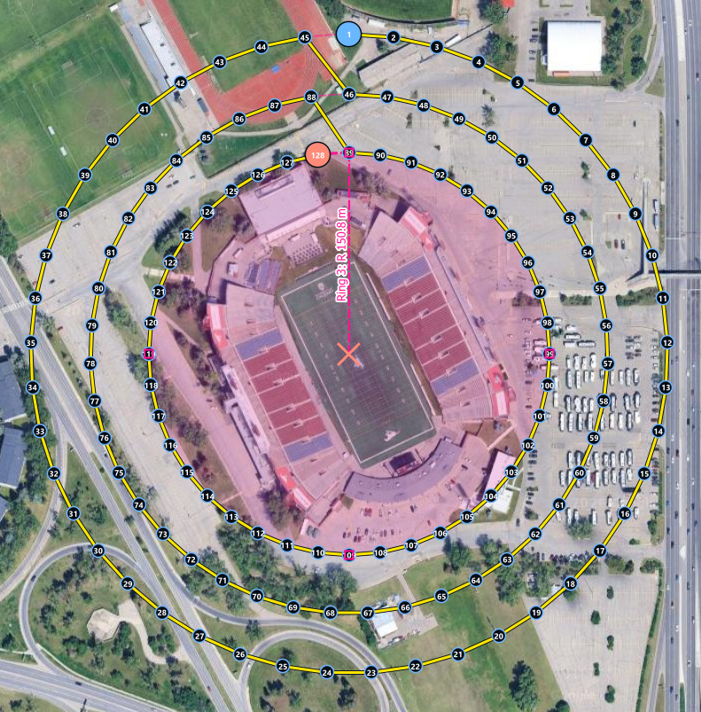

- **+ Add Ring** adds up to 3 rings around the same centre, each with its own **Radius**, **Altitude** and **Camera Tilt**. They are flown in order.
- **Edit** moves or resizes the circle with handles; **Remove** clears it.
- **Reverse route** flies the rings counterclockwise.
- Rings that need more than one battery are split into flights, whole rings first.

---

## Choosing how the drone flies

### Capture: Semi or Full

Set under **Mission Setup > Capture**. It works with every mission type.

- **Semi:** FlyPath places waypoints only where the drone turns. Before takeoff, set the camera to interval capture (its shortest interval is shown next to **Front Overlap**). Fewer waypoints and a shorter flight.
- **Full:** FlyPath places a waypoint at every photo and the drone takes each photo by itself. Exact overlap with no camera setup, and the route stays on the lines in DJI Fly.

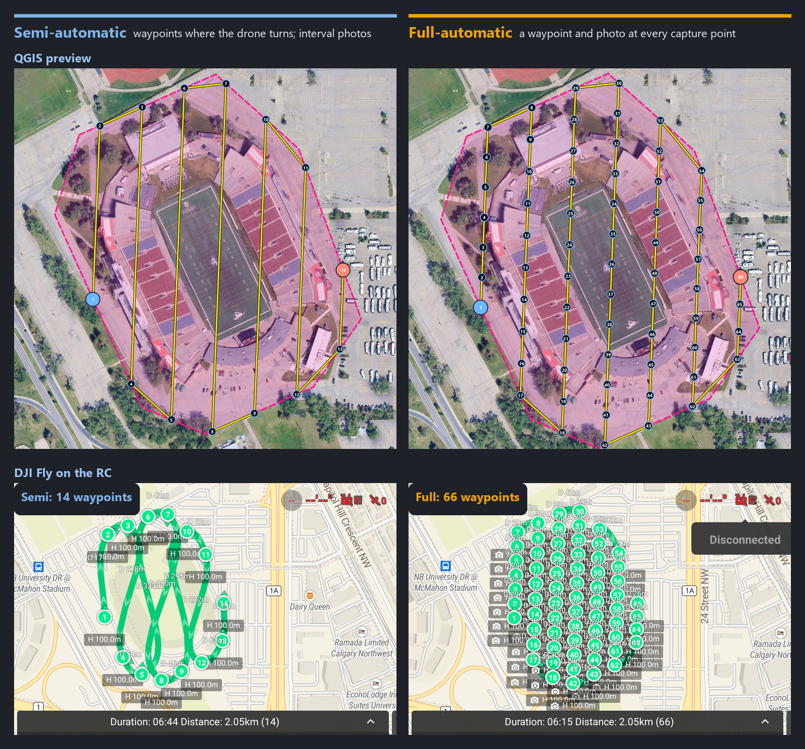

### Flight Path: Curved or Straight

Set under **Mission Setup > Flight Path**. The QGIS preview looks the same either way; the difference shows in DJI Fly.

- **Curved** (recommended): DJI Fly's own path. It survives saving or cloud-syncing the mission on the controller. With far-apart waypoints (Semi), the path bends between them; with Full capture it stays on the lines.
- **Straight:** exact straight lines with a stop at each waypoint. If you save the mission again on the controller, DJI Fly can reconnect the waypoints out of order, so use it only when you will not re-save it there.

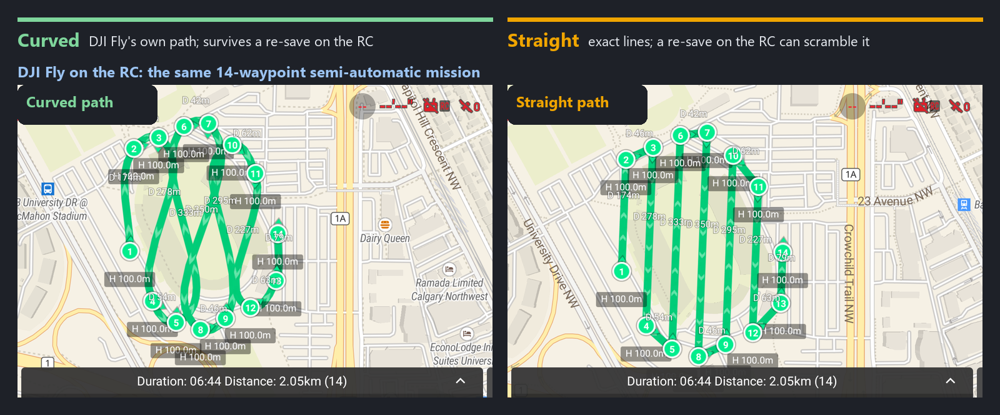

### Cross-hatch

Set under **Adv. Mission Organizers > Route Options** (2D Mapping only). It flies the grid a second time at 90°, which helps 3D models and LiDAR point clouds. It roughly doubles the flight time, photos and battery use.

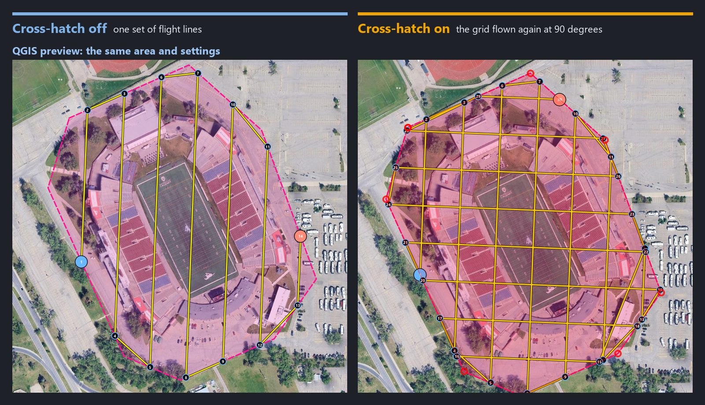

### Reverse route

Starts the mission from the other end. In Oblique Mapping each pass starts from its other end; in Orbit the rings are flown counterclockwise.

---

## Terrain, takeoff and splitting

### Terrain follow

Tick **Terrain follow** under Route Options. Each waypoint's height changes so the drone stays at the same height above the ground, using free online elevation data, or a DEM you select under Survey Area.

- **Full:** a height is set at every photo.
- **Semi:** a waypoint is added along a line only where the ground has risen or fallen by more than the **Terrain Tolerance**.
- **Oblique:** the height follows the higher of the ground below the drone and the ground the tilted camera looks at, so the drone never gets low over rising ground.

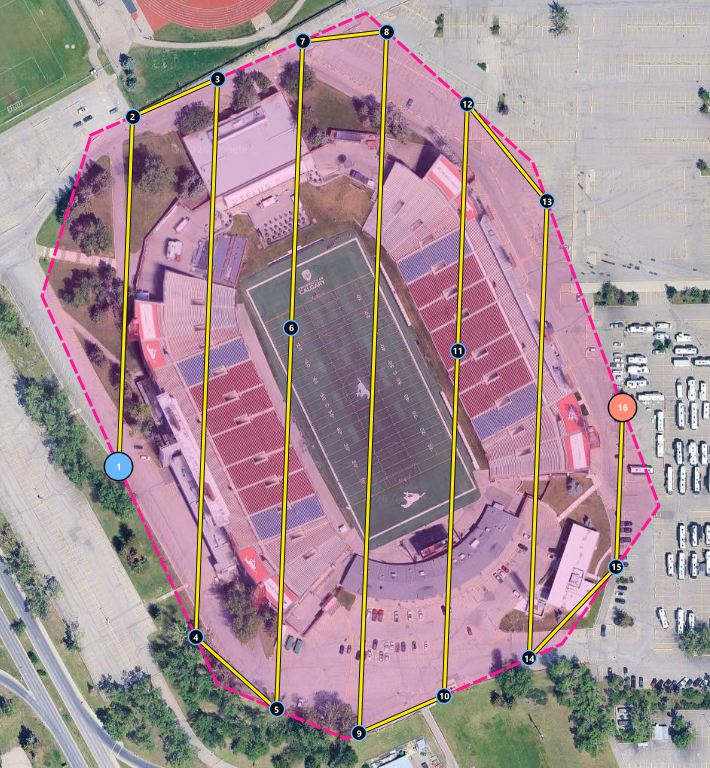

It follows bare ground, not trees or buildings, so keep a safe height. Elevation data is only kept in memory while you plan.

### Takeoff Zone and contours

DJI consumer missions fly at heights measured from the takeoff point. If you take off lower or higher than the first waypoint, the whole mission flies higher or lower than planned, and the GSD changes from one flight to the next.

Click **Show Takeoff Zone** to shade the ground near the first waypoint that is at the same height, within the **Tolerance** you set (shown as **GSD Variance**). Take off inside the zone and every repeat flight matches. **Show Contours** draws elevation contours over the area or the takeoff circles.

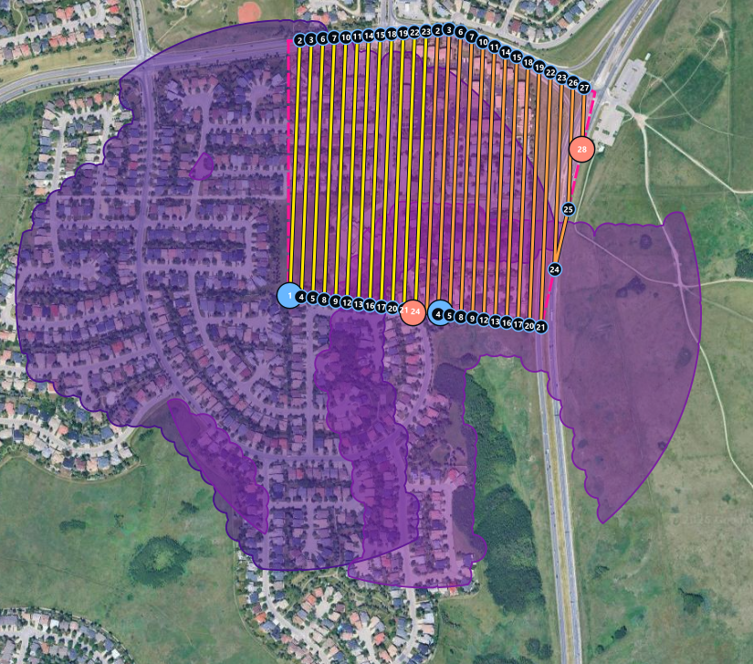

If you take off from something above the ground, such as a car roof, enter its height in **Launch Offset** and FlyPath corrects every waypoint height.

### Splitting into flights

Tick **Enable splitting** under Mission Splitting. FlyPath divides the mission into flights that each fit one battery and the **Max Waypoints** limit. **Split Missions** sets the smallest number of flights you want.

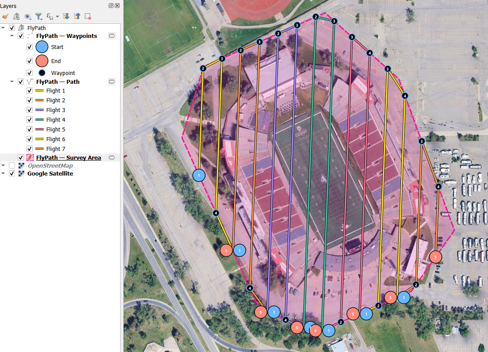

- Each flight is drawn in its own colour, with its own start and end markers, and listed in the Layers panel.
- **Save to computer** writes one KMZ per flight. **Send to DJI RC** sends one flight at a time, picked in **Mission part**.
- Flights of one pass or one ring share their joining waypoint, so each flight starts where the last one ended.

---

## Step-by-step guide

### Step 1: Define the survey area

Under **Survey Area**, choose the **Source**:

- **Draw:** click **Draw Polygon on Map**, left-click to add points, right-click to finish. Backspace removes the last point and Escape cancels. **Edit** and **Remove** change or clear it.
- **Layer:** pick a polygon layer and feature already in your QGIS project.
- **Selection:** select a feature on the map with the QGIS selection tools, then click **Use QGIS Selection**.

Only one area is active at a time. Corridor Mapping uses a **line** instead of a polygon, in the same three ways, and shows its **Length** instead of its area. Orbit uses a **circle**: click **Draw Circle on Map** on the object, or press and drag to set the radius.

**DEM** (optional) picks a loaded elevation raster for terrain follow, the takeoff zone and contours. Leave it on "none" to use the online data.

### Step 2: Set up the flight

#### Mission Setup

| Setting | What it does |
|---|---|
| Mission Type | **2D Mapping**, **Oblique Mapping**, **Corridor Mapping** or **Orbit (3D Model)**. See [Mission types](#mission-types) |
| Capture | **Semi** or **Full**. See [Capture](#capture-semi-or-full) |
| Flight Path | **Curved** (recommended) or **Straight**. See [Flight Path](#flight-path-curved-or-straight) |
| Drone | Your drone model. It sets the camera used for GSD and photo spacing |

#### Flight Parameters

| Setting | What it does |
|---|---|
| Altitude | Height above the takeoff point, in metres. In an orbit with several rings, the selected ring's altitude |
| GSD | Ground detail per pixel, in cm. Linked to altitude: change one and the other follows |
| Side Overlap | How much neighbouring lines overlap. Higher means more lines |
| Front Overlap | **Full:** how much photos overlap along a line. **Semi:** the overlap you will get from the speed and the camera interval, shown with the shortest interval |
| Speed | Flight speed in m/s, within your drone's range |
| Direction | 2D and Oblique. The angle of the lines; **Auto** picks the shortest route |
| Margin | 2D and Oblique. Extends the survey area outward, in metres |
| Buffer | Corridor only. How far to map on each side of the centre line |
| Pattern | Oblique only. **Fast** or **Full** |
| Camera Angle | Oblique only. Camera tilt of the oblique passes, -85° to -20°; -45° to -60° suits 3D models |
| Nadir Pass | Oblique only. Fly the area straight down before the oblique passes (on by default) |
| Radius | Orbit only. Size of the selected ring, in metres |
| Camera Tilt | Orbit only. Camera tilt of the selected ring: 0° is the horizon, -90° straight down |

2D and Corridor missions always look straight down (-90°).

#### Adv. Mission Organizers

| Setting | What it does |
|---|---|
| Enable splitting | Divide the mission into several flights |
| Split Missions / Min Flights | The smallest number of flights. Corridor calls it **Min Flights** and splits the line into stretches |
| Max Waypoints | The most waypoints in one flight (DJI allows about 200). Orbits use 200 |
| Cross-hatch | 2D only. Fly the grid again at 90° |
| Reverse route | Start from the other end; in Orbit, fly counterclockwise |
| Terrain follow | Keep the same height above the ground |
| Terrain Tolerance | Semi with terrain follow. How much the ground must change before a waypoint is added |
| Set Mission Breaks | Corridor only. Click line vertices to force a break between flights |

#### Takeoff Zone

| Setting | What it does |
|---|---|
| Show Takeoff Zone | Shade the ground you can take off from at the right height |
| Show Contours | Draw elevation contours over the survey area or the takeoff circles |
| Tolerance | How much height difference is allowed, shown as **GSD Variance** |
| Launch Offset | Height of what you take off from, if not the ground |
| Same takeoff for all splits | All flights take off from the first flight's start |

#### Safety Actions

| Setting | What it does |
|---|---|
| Finish | After the last waypoint: Return to Home, Hover, or Land |
| RC Lost | If the controller signal is lost: Return to Home, Hover, Land, or Continue mission |

> **Photos in Semi capture:** DJI consumer drones do not start interval photos from the mission file. Set interval capture on the drone before takeoff. In Full capture the mission takes every photo itself.

### Step 3: Preview on map

Click **Preview on Map**. FlyPath draws the route:

- **Pink dashed outline:** the survey area.
- **Yellow lines:** the flight path (each flight gets its own colour when split).
- **Blue circle:** the start. **Coral circle:** the end. **Small numbered dots:** the waypoints.

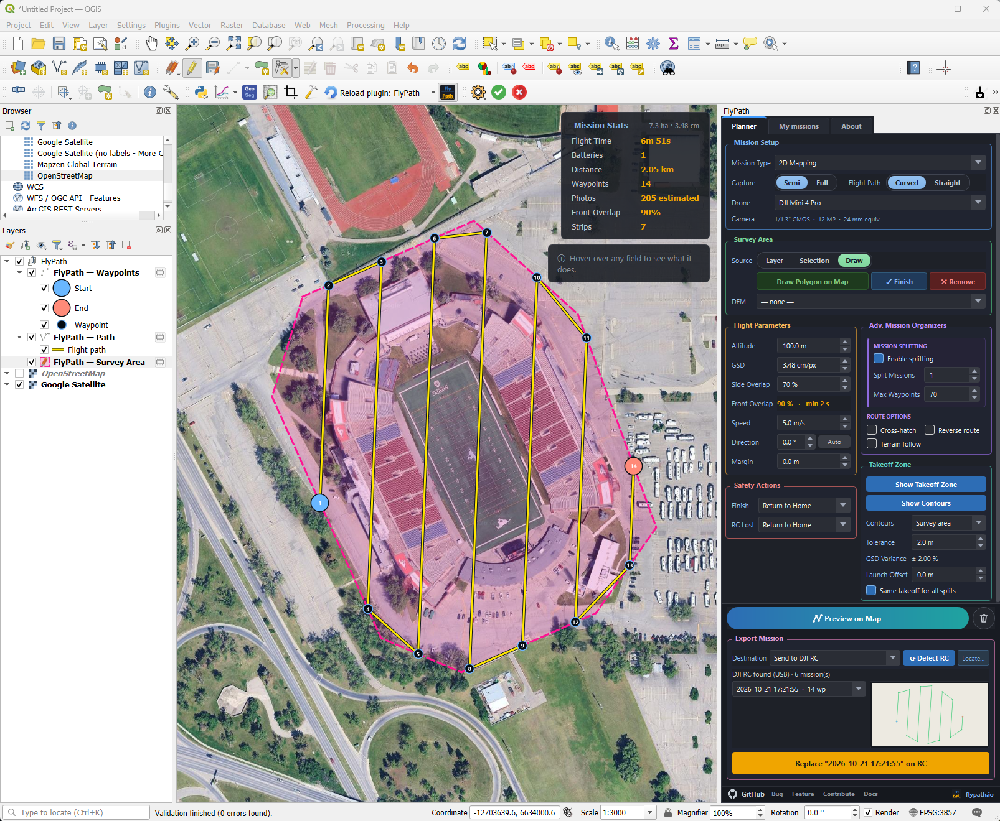

The **Mission Stats** card on the map shows the flight time, batteries, distance, waypoints, photos, front overlap and lines. Once the preview is on the map, changing a setting redraws the route and the numbers straight away. Hover over any setting for a short explanation.

### Step 4: Export

Under **Export Mission**, choose the **Destination**. FlyPath starts on **Send to DJI RC** and then remembers your last choice.

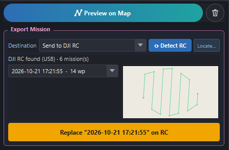

#### Send to DJI RC

FlyPath **replaces** a mission that already exists on the RC; DJI Fly does not show missions it did not create. So first create a waypoint mission in DJI Fly (a 3-point mission is enough), one for each flight you want to send.

1. Connect the RC to your computer with USB and allow file transfer on the RC.
2. Click **⟳ Detect RC**. FlyPath finds the RC and lists its missions by date and waypoint count, each with a picture of its route.
3. If it is not found, click **Locate…** and browse to the RC's `waypoint` folder.
4. Pick the mission to replace. Click its picture to see it larger.
5. If the mission is split, choose the flight in **Mission part**.
6. Click **Replace "…" on RC**.
7. Unplug the RC, then close and reopen DJI Fly.

The mission in DJI Fly on the RC:

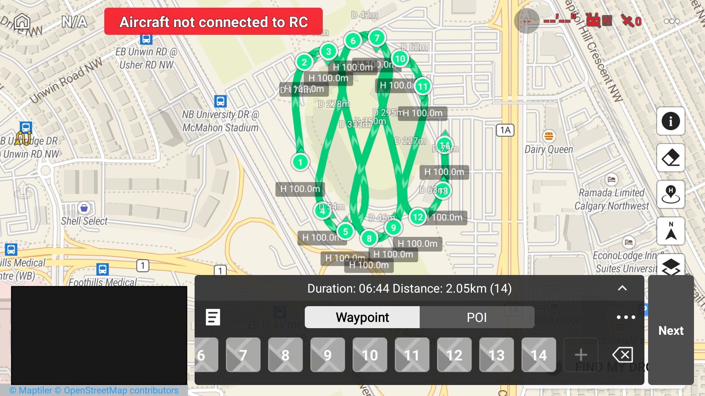

#### Save to computer

1. Set **Destination** to **Save to computer**.
2. Click **Browse…** and choose a folder (it is remembered).
3. Click **Export KMZ** and confirm the file name.

A split mission is saved as one file per flight: `<name>_1_of_N.kmz`, `<name>_2_of_N.kmz`, and so on.

---

## Your missions on flypath.io

[flypath.io](https://flypath.io) is FlyPath's website: a mission planner in the browser, and the home for your missions.

### What it is for

| | QGIS plugin | flypath.io |
|---|---|---|
| Best for | Planning with your GIS data (layers, selections, DEMs) and sending missions to the DJI RC | Keeping all your missions in one place, sharing them, and planning in any browser without QGIS |
| Works offline | Yes, once installed | No, it is a website |
| Account | Not needed | Free account |

Coming to flypath.io: 2D maps and 3D models made in the cloud from the photos of the missions you fly.

### How the plugin and the website work together

Both use the **same planning engine**. A mission planned in one opens in the other with exactly the same route, waypoints and flights, so you can move between them freely. For example:

1. Plan a mission in QGIS and click **Save to FlyPath…**.
2. Open it on flypath.io to check it, change it, or share it with a client or a pilot.
3. Back in QGIS, open it from **My missions** and send it to the RC.

Opening a mission keeps its saved route as it was; FlyPath only plans it again when you click **Regenerate on Map**.

### Using My missions

Open the **My missions** tab and click **Connect account**. Paste the token from **Plugin token** in your flypath.io account menu. QGIS keeps it in its encrypted password store. Missions in a website project are grouped under that project; the rest are under **Standalone missions**.

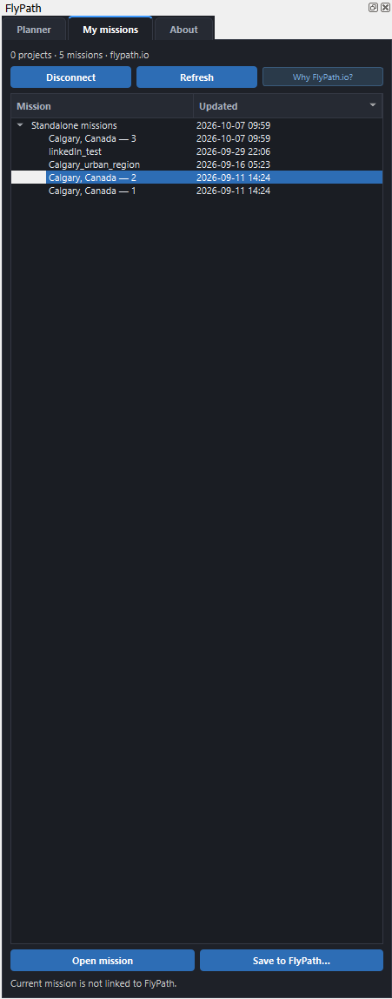

- **Open mission** loads it into the Planner and centres the map on it.
- **Save to FlyPath…** saves your current plan. After the first save, it updates the same mission on the website.
- **Save as new…** saves a separate copy, in a project of your choice or as a standalone mission.
- If someone changed the mission on the website after you opened it, FlyPath does not overwrite their work. It asks whether to load the latest version, save yours as a copy, or cancel; your local plan is kept.
- Projects are created and renamed on the website.

**What syncs:** 2D, Corridor, Orbit (with rings and splitting) and Oblique missions with the consumer drones FlyPath supports. A few cases do not open in QGIS yet: reversed corridor routes, terrain-follow routes and routes from older versions stay on the website. Oblique missions with terrain follow stay local for now: export them, or turn terrain follow off before saving.

Not connected yet? The tab explains what an account adds and links to [flypath.io/register](https://flypath.io/register/).

---

## Supported drones

| Drone | Status |
|---|---|
| DJI Mini 3 Pro | Community-verified |
| DJI Mini 4 Pro | Verified with a mission made on the RC2 |
| DJI Mini 5 Pro | Community-verified |
| DJI Air 3 | Field-test reports wanted |
| DJI Air 3S | Field-test reports wanted |
| DJI Mavic 3 Classic | Field-test reports wanted |
| DJI Mavic 4 Pro | Field-test reports wanted |
| DJI Lito X1 | Field-test reports wanted |

> The standard DJI Mini 3 has no waypoint missions, so it is not supported. Of the Mavic 3 family only the single-camera Mavic 3 Classic is supported. On the Air 3, Air 3S and Mavic 4 Pro, select the wide (main) camera for mapping.

If DJI Fly rejects a mission on one of the "reports wanted" drones, please [open an issue](https://github.com/dronnix-io/FlyPath/issues) so we can fix it.

---

## Requirements

| Requirement | Details |
|---|---|
| Operating system | Windows 10 / 11 or Linux |
| QGIS | 3.34 or later, including QGIS 4; tested on 3.44 and 4.0 |
| Drone | One of the [supported drones](#supported-drones) |
| Controller | DJI RC2, for sending missions over USB |
| Python libraries | Shapely 2.1+ and pyproj 3.7+, included with current QGIS releases |

Planning works offline once the plugin is installed. Terrain follow needs an internet connection while planning, unless you select your own DEM.

---

## Installation

### Option A: QGIS Plugin Manager (recommended)

1. In QGIS go to **Plugins > Manage and Install Plugins**.
2. Search for **FlyPath** and click **Install Plugin**.

### Option B: Install from ZIP

1. Download the latest `FlyPath-<version>.zip` from the [Releases](https://github.com/dronnix-io/FlyPath/releases) page.
2. In QGIS go to **Plugins > Manage and Install Plugins > Install from ZIP**.
3. Select the ZIP and click **Install Plugin**.

### Option C: From source

```shell
git clone https://github.com/dronnix-io/FlyPath.git
cd FlyPath
python tools/vendor_engine.py
```

The last command fetches the planning engine the plugin needs. Then copy or link the `FlyPath` folder into your QGIS plugins folder:

```
Windows: C:\Users\<you>\AppData\Roaming\QGIS\QGIS3\profiles\default\python\plugins\
Linux:   ~/.local/share/QGIS/QGIS3/profiles/default/python/plugins/
```

Enable it under **Plugins > Manage and Install Plugins > Installed > FlyPath**. See [CONTRIBUTING.md](CONTRIBUTING.md) for building the ZIP and running the checks.

### Open the plugin

Go to **Plugins > FlyPath > FlyPath**, or click the FlyPath icon in the toolbar. The panel has three tabs: **Planner**, **My missions** and **About**.

---

## Known limitations

- Tested on Windows 10 / 11 and Linux. macOS is planned.
- Sending to the RC needs a DJI RC2 over USB, with one existing DJI Fly mission for each flight you send.
- Terrain follow uses a bare-earth elevation model of about 30 m, so it does not see trees or buildings. Heights are measured from takeoff at the first waypoint of each flight.
- Oblique terrain follow works out where the camera looks at takeoff level, so on steep slopes the photo centres move a little. Oblique missions with terrain follow cannot be saved to flypath.io yet.
- Orbit missions do not use terrain follow.
- Corridor and 2D missions always look straight down. Mission Breaks go on the centre line's existing vertices.
- The Mini 3 Pro mission settings are community-verified, not confirmed from a mission made on its controller.

---

## Contributing

Contributions are welcome. Fork the repository, create a branch, and open a pull request against `main`. [CONTRIBUTING.md](CONTRIBUTING.md) explains the checks to run before you push.

For bugs and ideas, use the [issue tracker](https://github.com/dronnix-io/FlyPath/issues).

### From inside the plugin

A links bar at the bottom of the panel opens the GitHub repository, bug reports, feature requests, the contributing guide, the docs and flypath.io:


The **About** tab describes FlyPath's mission, what it supports now and what is coming next, with buttons to report a bug or request a feature.

### Project structure

```
FlyPath/
├── flypath.py                  # QGIS plugin entry point and the three tabs
├── flypath_dialog.py           # Planner panel, preview and export
├── survey_controller.py        # Survey area drawing, layers and selection
├── orbit_controller.py         # Orbit (3D Model) circle, rings and controls
├── planning_adapter.py         # Requests to and results from the planning engine
├── flypath_engine/             # Planning engine (fetched by tools/vendor_engine.py)
├── terrain.py                  # Terrain follow heights
├── takeoff_zone.py, contours.py
├── preview_layers.py           # Map preview layers
├── mission_export.py, wpml/    # DJI WPML KMZ writing
├── controller_storage.py       # Finding and writing missions on the DJI RC
├── flypath_library.py          # My missions tab
├── website_sync_controller.py  # Saving to and opening from flypath.io
├── flypath_sync.py, flypath_credentials.py
├── about_tab.py                # About tab
├── hardware/                   # Drone list
├── tools/, tests/
└── docs/images/                # README pictures
```

---

## License

FlyPath is licensed under the **GNU General Public License v3.0**. See [LICENSE](LICENSE).

---

## About Dronnix

[Dronnix](https://www.dronnix.com) is a drone mapping and geospatial AI company, working on solar panel inspection, agriculture, urban growth monitoring, construction progress and large-scale mapping.

FlyPath is free and open source, made to support the drone mapping community. Its website is [flypath.io](https://flypath.io).

**Contact:** [salar@dronnix.com](mailto:salar@dronnix.com)
